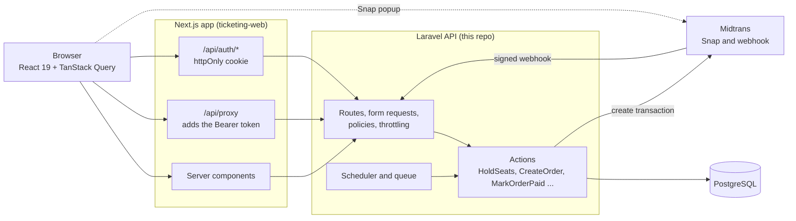
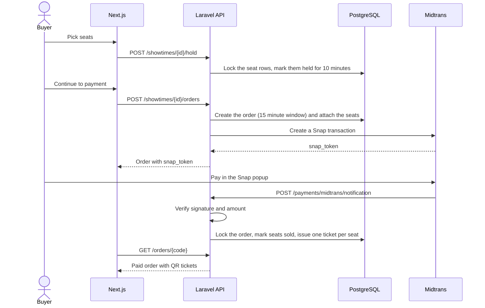
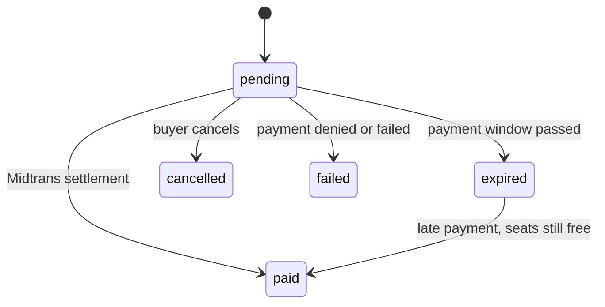
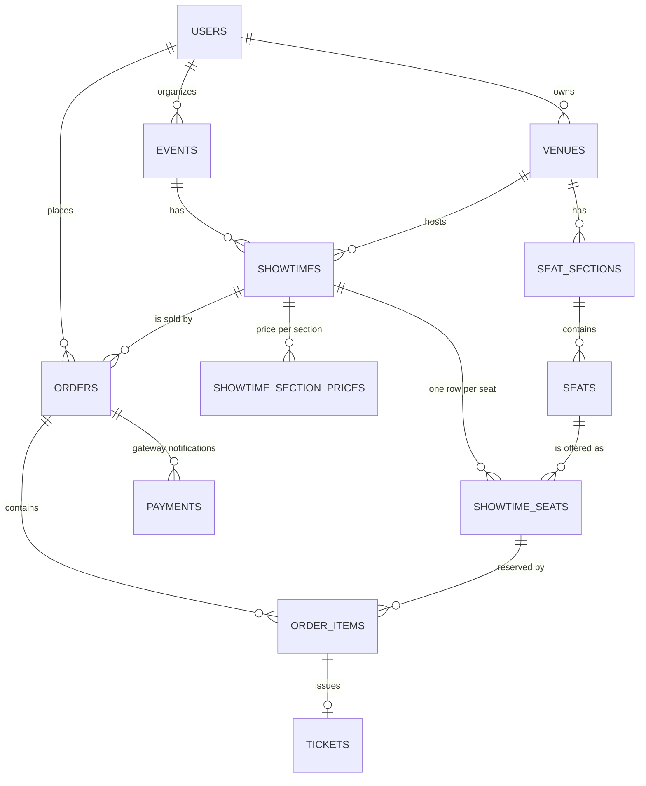

# Ticketing API

The backend for a ticketing platform for films, concerts, orchestras and other events. Organizers publish events with reserved seating, attendees pick exact seats and pay online through Midtrans, and admins review events before they go live.

Built with Laravel and PostgreSQL. The web client is a separate Next.js app, `ticketing-web`.

## What it does

| Role | Can do |
| --- | --- |
| Attendee | Browse and search events, see a live seat map, hold up to 6 seats, pay with Midtrans, get one QR-coded ticket per seat, see order history and notifications |
| Organizer | Create venues with a seat-grid generator, create events with a poster, schedule showtimes with per-section prices, submit events for review |
| Admin | Review submitted events, approve or reject with a reason the organizer sees |

Events move through `draft` -> `pending_review` -> `published` (or `rejected`, then back to editing). Only published events with an upcoming showtime appear in the public catalog.

## Architecture



### Buying a ticket



### Order lifecycle



## Engineering notes

**No double-booked seats, enforced twice.** Holding seats runs in one transaction with row locks and is all-or-nothing: either every requested seat is held or none is. As a second line of defense, a partial unique index (`order_items_active_seat_unique`, on `showtime_seat_id` where `released_at IS NULL`) makes it impossible for two active orders to contain the same seat, even if application code had a bug. A concurrency test fires five real OS processes at the same seats and asserts exactly one wins.

**Holds and orders expire on time.** A hold lasts 10 minutes and an order has a 15 minute payment window. The scheduler expires stale orders every minute, and `HoldSeats` also expires stale orders for that showtime right before it locks, so a seat is free the moment its time is up instead of up to a minute later.

**The payment webhook is treated as untrusted input.** The Midtrans signature (`SHA512(order_id + status_code + gross_amount + server_key)`) is verified, the paid amount must equal what was charged, and processing is idempotent. The order row is locked and each `(transaction_id, transaction_status)` pair is recorded once, so retried or simultaneous notifications apply once. Every notification is stored in `payments` as raw JSON for auditing.

**Missing webhooks and late payments are handled.** `POST /orders/{code}/sync` asks Midtrans for the current status and applies it exactly like a webhook, so payments still complete when the webhook cannot reach the server (for example on localhost). If someone pays after their order expired, the seats are re-claimed only if they are still free. Otherwise the order stays expired and the payment is kept for a manual refund. There are no automatic refunds.

**Authorization is layered.** Sanctum bearer tokens identify users, a role middleware guards the organizer and admin route groups, policies check ownership (an organizer can only touch their own venues, events and showtimes), and form requests validate every input. Admins cannot self-register; they are promoted with an artisan command. Sensitive endpoints are rate limited.

**Smaller decisions.**
- Money is stored as unsigned integer rupiah, never floats.
- Business logic lives in single-purpose Action classes (`HoldSeats`, `CreateOrder`, `ReleaseOrder`, `MarkOrderPaid`, `ReviewEvent`, ...), which keeps controllers thin and each rule easy to test.
- Seat layouts are defined once per venue and reused by every showtime. Each showtime gets its own `showtime_seats` rows, with a price per section set per showtime.
- Notifications (order paid, event approved, event rejected) are queued and sent by mail and stored in the database, so a slow mail server never delays a payment or a review.
- Poster uploads accept JPG, PNG and WebP up to 2 MB. SVG is rejected because it can carry scripts.

## Data model



## API overview

All routes are under `/api`. Protected routes need `Authorization: Bearer <token>`.

| Area | Endpoints |
| --- | --- |
| Public catalog | `GET /events` (filters: `search`, `category`, `city`), `GET /events/{slug}`, `GET /showtimes/{id}/seats` |
| Auth | `POST /auth/register`, `POST /auth/login`, `POST /auth/logout`, `GET /auth/me` |
| Buying | `POST` and `DELETE /showtimes/{id}/hold`, `POST /showtimes/{id}/orders`, `GET /orders`, `GET /orders/{code}`, `POST /orders/{code}/sync`, `POST /orders/{code}/cancel` |
| Notifications | `GET /notifications`, `POST /notifications/read-all`, `POST /notifications/{id}/read` |
| Organizer | `venues` and `events` resources, `POST /organizer/events/{id}/submit`, `POST /organizer/events/{id}/poster`, `GET` and `POST /organizer/events/{id}/showtimes`, `POST /organizer/showtimes/{id}/cancel` |
| Admin | `GET /admin/events?status=`, `GET /admin/events/{id}`, `POST /admin/events/{id}/approve`, `POST /admin/events/{id}/reject` |
| Payments | `POST /payments/midtrans/notification` (public, protected by its signature) |

## Running it locally

You need PHP, Composer and PostgreSQL. It is developed on PHP 8.5 with Laravel Herd on Windows.

```bash
composer install
cp .env.example .env          # Windows PowerShell: copy .env.example .env
php artisan key:generate

# In .env: set the DB_* values for PostgreSQL and the MIDTRANS_* keys (see below)

php artisan migrate --seed    # schema, demo accounts and three demo events
php artisan storage:link      # so uploaded posters are served
php artisan serve             # http://127.0.0.1:8000
```

Two background processes make the system behave like production. Run each in its own terminal:

```bash
php artisan schedule:work     # expires unpaid orders and old seat holds every minute
php artisan queue:work        # sends queued notifications
```

If you do not want a queue worker locally, set `QUEUE_CONNECTION=sync` in `.env`. Mail uses the `log` mailer by default, so emails are written to `storage/logs`.

### Demo accounts

Created by the seeder in `local` and `testing` environments only. The password for all of them is `password`.

| Role | Email |
| --- | --- |
| Admin | `admin@example.com` |
| Organizer | `organizer@example.com` |
| Attendee | `attendee@example.com` |

To make a real account an admin: `php artisan users:make-admin someone@example.com`.

### Midtrans sandbox

1. Create a free account at Midtrans and switch the dashboard to **Sandbox**.
2. Copy the Server Key and Client Key from Settings > Access Keys into `.env`.
3. Pay with the sandbox test card `4811 1111 1111 1114`, any future expiry date, CVV `123`, OTP `112233`.

Midtrans cannot reach `localhost`, so the webhook will not arrive by itself. Either use the "check status" button in the web app (it calls the sync endpoint), or expose the API with a tunnel and set the Payment Notification URL in the Midtrans dashboard to `https://<your-tunnel>/api/payments/midtrans/notification`.

### Environment variables

| Variable | Purpose |
| --- | --- |
| `APP_URL` | Public URL of this API. Poster URLs are built from it |
| `FRONTEND_URL` | URL of the Next.js app, used in notification links (default `http://localhost:3000`) |
| `DB_CONNECTION`, `DB_HOST`, `DB_PORT`, `DB_DATABASE`, `DB_USERNAME`, `DB_PASSWORD` | PostgreSQL connection |
| `MIDTRANS_SERVER_KEY`, `MIDTRANS_CLIENT_KEY` | Midtrans credentials |
| `MIDTRANS_IS_PRODUCTION` | `false` for sandbox |
| `QUEUE_CONNECTION` | `database` with a worker, or `sync` for local development |
| `MAIL_*` | Mail transport for notifications |

## Tests

```bash
php artisan test
```

More than 170 feature tests cover authentication and roles, venue and seat generation, seat holds (including the concurrency test), the public catalog, organizer endpoints, admin review, notifications, orders, the Midtrans webhook (signature, amount mismatch, duplicates, late payment) and order expiry. Midtrans is faked, so no network or keys are needed. The tests run against PostgreSQL, because they rely on row locks and a partial unique index; set a separate test database in `phpunit.xml`.

## Project layout

```
app/
  Actions/            business rules, one class per use case
  Console/Commands/   orders:expire, seats:release-expired, users:make-admin
  Enums/              statuses and roles
  Http/
    Controllers/Api/  thin controllers (Organizer/ and Admin/ subfolders)
    Requests/         validation
    Resources/        JSON shapes
  Models/
  Notifications/      OrderPaid, EventApproved, EventRejected
  Policies/           ownership rules
  Services/Midtrans/  payment gateway client
database/             migrations, factories, seeders
routes/api.php
tests/Feature/
```

## Not built yet

- Ticket check-in. The `tickets` table already has `checked_in_at` and `checked_in_by`; the scan endpoint is next.
- Automatic refunds. Late payments on expired orders are kept for manual handling.
- Email verification and password reset.
- General admission (unseated) tickets. Every ticket is for a specific seat.
